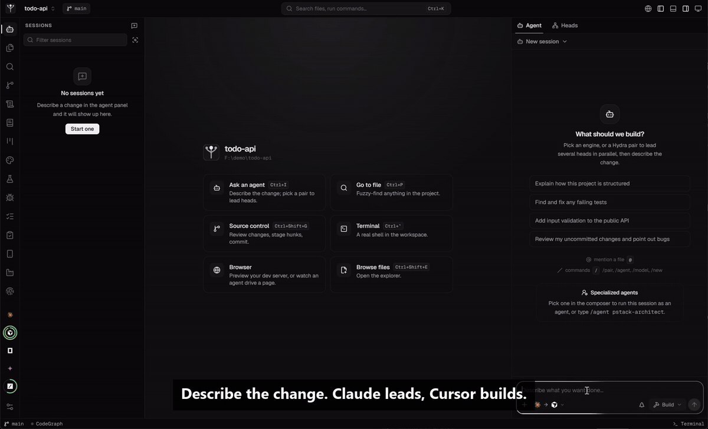

<div align="center">

# TreeBoss

Run Claude Code, Codex and Cursor from one app, on the subscriptions you already pay for. One agent leads, others build in their own git worktrees, and nothing reaches your code until you merge it.

       

</div>

<p align="center"></p>

## What it does

- **Uses the CLIs you already have.** TreeBoss starts `claude`, `codex`, `cursor-agent` and `opencode` as they are installed and signed in on your machine. It never sees an API key and never calls a model provider itself.
- **One lead, several heads.** You pick who leads and what the heads run on, for example Opus leading Codex. The lead opens helper sessions in the middle of its turn, keeps working while they run, then reviews and merges what they did.
- **A worktree per head.** Each head edits its own git worktree. Its changes reach your checkout only through `merge`, as uncommitted edits you can read first.
- **Sessions resume.** A follow-up continues the engine's own conversation with its full context, from the CLI, the web UI or the desktop app.

There is more around that: a code index (CodeGraph) handed to every engine, specs and plans kept as plain files in your repo, checkpoints and rewind, a browser preview you can pick elements from, and a software factory with autopilot runs, PRs and CI, deploys and Expo releases. The [guide](docs/GUIDE.md) covers all of it.

```sh
trb run -p "Opus leads Codex" "add pagination to the users endpoint, with tests"
```

## Download

Desktop builds for Windows, macOS and Linux are on the [latest release](https://github.com/marius-pieptea/treeboss/releases/latest). The app bundles its own daemon, so you don't need Bun. You still need git and at least one engine CLI signed in.

The builds are not code-signed yet. The release notes say how to get past the warning on first launch.

## Install from source

You need [Bun](https://bun.sh) 1.2 or later, git, and at least one engine CLI signed in. It runs on macOS, Linux and Windows.

```sh
git clone https://github.com/marius-pieptea/treeboss
cd treeboss && bun install
bun run build:web                          # builds the UI the daemon serves (web/dist)
ln -s "$PWD/bin/trb" ~/.local/bin/trb      # or anywhere on PATH
trb doctor                                 # lists the engines it found
trb ui                                     # opens the UI on the current folder
```

State lives in `~/.treeboss` (`TRB_HOME` overrides): one SQLite file, worktrees, generated MCP configs, skills, the daemon log, and a 0600 `token`.

## Quick start

```sh
trb run "explain what src/db.ts does"                 # a plain session on the default engine (claude)
trb run -e codex "fix the failing test"               # pick the engine (-m <model>, --effort <level> too)
trb run -d "long refactor…"                           # detach; prints the session id
trb attach last                                       # follow it live
trb send last "also update the docs"                  # follow-up, resumes the engine session
trb ls  /  trb show last  /  trb logs last -f
```

The daemon starts on demand and stays up (`trb daemon status|stop|restart|logs`). Ctrl-C during `trb run` interrupts the turn but keeps the session, so `trb send` resumes where it stopped. `<id>` can be a unique prefix or `last`.

## Safety

> [!WARNING]
> Print-mode turns cannot ask a human, so every engine runs in its "no prompts" mode (`--dangerously-skip-permissions`, `--dangerously-bypass-approvals-and-sandbox`, …). **The net is isolation, not prompting:** heads run in worktrees outside your repo, a lead runs where you point it. Treat a lead in your real checkout like `claude --dangerously-skip-permissions`, because it is. Use `trb run -w` to give a lead its own worktree too.

The daemon listens on `127.0.0.1` only. The [safety model](docs/GUIDE.md#safety-model) has the details.

## Learn more

The [guide](docs/GUIDE.md) has a section for each part of TreeBoss:

- [Factory](docs/GUIDE.md#factory)
- [Hydra](docs/GUIDE.md#hydra)
- [The UI](docs/GUIDE.md#the-ui)
- [Specialized agents](docs/GUIDE.md#specialized-agents)
- [Plan mode](docs/GUIDE.md#plan-mode)
- [Specs](docs/GUIDE.md#specs)
- [Docs](docs/GUIDE.md#docs)
- [Roadmap](docs/GUIDE.md#roadmap)
- [Design systems](docs/GUIDE.md#design-systems)
- [Context, compaction and handoff](docs/GUIDE.md#context-compaction-and-handoff)
- [Checkpoints and rewind](docs/GUIDE.md#checkpoints-and-rewind)
- [Verify before done](docs/GUIDE.md#verify-before-done)
- [Evidence](docs/GUIDE.md#evidence)
- [CodeGraph](docs/GUIDE.md#codegraph)
- [Run the app, and pick elements in the preview](docs/GUIDE.md#run-the-app-and-pick-elements-in-the-preview)
- [The agent browser](docs/GUIDE.md#the-agent-browser)
- [MCP servers and skills](docs/GUIDE.md#mcp-servers-and-skills)
- [Safety model](docs/GUIDE.md#safety-model)
- [Providers and subscriptions](docs/GUIDE.md#providers-and-subscriptions)
- [Settings](docs/GUIDE.md#settings)
- [How it fits together](docs/GUIDE.md#how-it-fits-together)
- [Development](docs/GUIDE.md#development)

Architecture: [docs/ARCHITECTURE.md](docs/ARCHITECTURE.md). Phone access: [docs/REMOTE.md](docs/REMOTE.md).

## Status

- **Verified live** (real CLIs, trivial prompts): claude lead + head with worktree isolation, merge, and role instructions; codex and cursor run and reach trb's MCP tools; opencode runs (no MCP).
- **Not verified**: agy and grok launch flags (ported from an earlier orchestrator whose versions of those CLIs differ), codex/cursor as full Hydra leads, long runs.
- **Not built yet**: ACP-driven engines (devin, omp); the tool-call budget watchdog; auto-continuation after `claude --max-turns`; per-parent cost caps; log rotation for `daemon.log`.
- Two sessions started in the *same* directory at the same time share any skill/MCP file trb materializes there (ref-counted), but their edits are not isolated from each other. That is what `-w` and subagent worktrees are for.

## License

TreeBoss is source-available under the [PolyForm Shield License 1.0.0](LICENSE). Use it for anything, for free: personal projects, client work, at your company, and to build and sell your own products. The one thing you may not do is sell TreeBoss itself, or offer a product or service that competes with it, such as a rebranded copy or a hosted version. To do that, ask for a commercial license. See [LICENSING.md](LICENSING.md).

This is not an OSI open-source license. Keep the [NOTICE](NOTICE) file when you share a copy. Contributions are welcome under the [CLA](CLA.md): see [CONTRIBUTING.md](CONTRIBUTING.md) and [SECURITY.md](SECURITY.md).

### Third-party software

Dependencies are installed from npm and are not vendored, except where [NOTICE](NOTICE) says so. Every direct dependency is under a permissive license and keeps it:

- **MIT:** [CodeGraph](https://github.com/colbymchenry/codegraph) (`@colbymchenry/codegraph`), CodeMirror, xterm.js, TanStack Query, Radix UI, React, react-markdown, remark-gfm, sonner, zustand, cmdk, clsx, tailwind-merge, tw-animate-css, qrcode-generator, unpdf.
- **Apache-2.0:** [Playwright](https://github.com/microsoft/playwright) (`playwright-core`), class-variance-authority.
- **ISC:** lucide-react.
- **SIL Open Font License 1.1:** the bundled fonts Geist, Geist Mono, Press Start 2P, Silkscreen and VT323 (via `@fontsource`).
- **[REA](https://github.com/morluto/rea), MIT:** not bundled. trb starts it with `npx` at a pinned version (6.4.0) when REA is on in Settings.

Adapted material from open-design (Apache-2.0) and pstack (MIT) is listed in [NOTICE](NOTICE).
